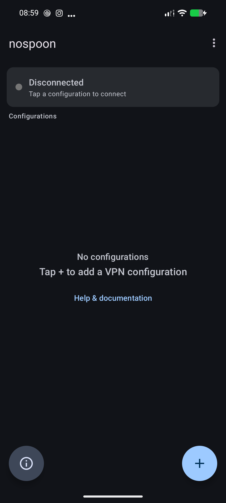
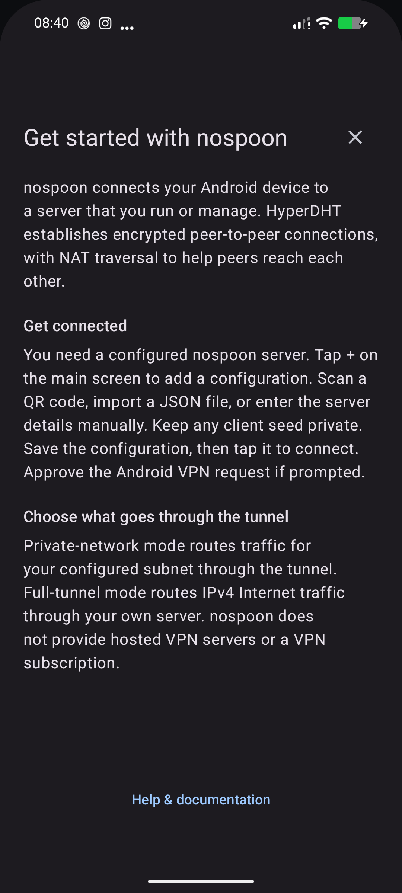
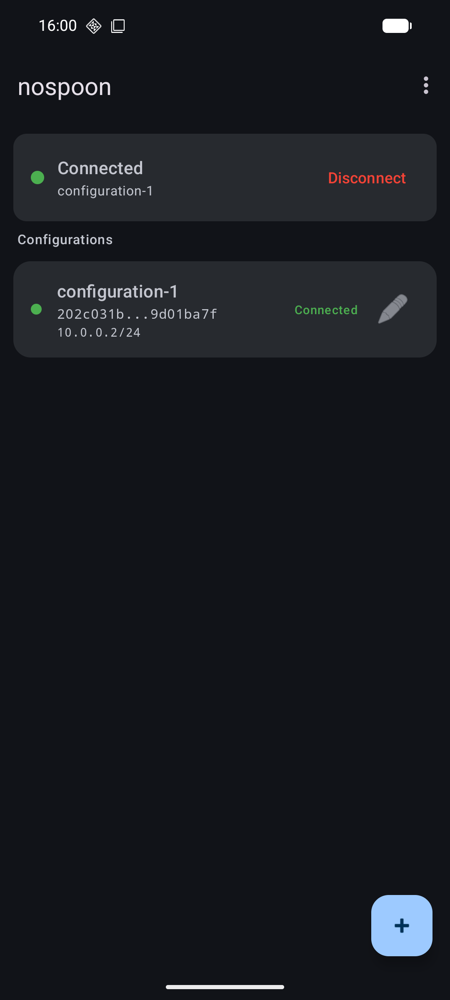

# nospoon Android

Android VPN client for [nospoon](https://github.com/jjacke13/nospoon). Kotlin
app on top of hyperdht-cpp through a JNI bridge — no JavaScript runtime, no
separate native binary.

The server, the desktop clients, the wire protocol and the config-format spec
live in the nospoon repo; this repo is only the app.

## Phone screenshots

| First setup | In-app guide | Connected example |
| --- | --- | --- |
|  |  |  |

The connected example was captured before the latest button refresh.

## Architecture

```
Kotlin                                   Native (libhyperdht_jni.so)
 NospoonVpnService (VpnService)           hyperdht-cpp + libudx + libsodium + libuv
  - VpnService.Builder owns the TUN fd     - HyperDHT client, holepunch, SecretStream
  - tun→stream / stream→tun coroutines     - own libuv loop on a dedicated thread
  - Framing.kt (length-prefix, 25 s KA)
  - reconnect loop, DHT rebuild
 MainActivity / ConfigEditorBottomSheet
  - config list, editor, QR + file import
        │                                          ▲
        └── com.hyperdht wrapper (HyperDHT.kt, Stream.kt, Native.kt) ──┘
```

The `com.hyperdht` Kotlin wrapper is vendored from
`hyperdht-cpp/wrappers/kotlin`. Ordinary laptop builds reuse hyperdht-cpp's
CI binary. The separate [F-Droid source-build recipe](docs/FDROID.md) builds
JNI from pinned Git submodules on a Linux CI/F-Droid host. Fetching these
modules downloads source only; ordinary laptop builds still use the prebuilt JNI.

### Startup sequence — DHT first, VPN later

`NospoonVpnService.runVpnLoop`:

1. Create a `HyperDHT` and bootstrap on the real network — no VPN routes exist
   yet, so nothing can black-hole the bootstrap.
2. `protect()` the DHT's UDP sockets (client + server fd) so later VPN routes
   never capture them.
3. `dht.connect(serverPk)` until a SecretStream opens.
4. Only then `VpnService.Builder.establish()` the TUN and start the two pumps.
5. Stream closes (peer gone, network change) → keep the TUN, reconnect the
   stream. After `MAX_FAILURES_BEFORE_RESTART = 3` consecutive connect failures
   the whole `HyperDHT` is torn down and rebuilt so its socket rebinds to the
   live interface (Wi-Fi ↔ mobile data).

`dht.onNetworkChange` is deliberately *not* acted on: our own `establish()`
registers the TUN as a new network and would self-trigger a reconnect.
Failure counting is the network-change detector.

Full-tunnel mode adds `0.0.0.0/0` + `addDisallowedApplication(packageName)`
(the app's own DHT traffic bypasses the tunnel) + DNS 1.1.1.1 / 8.8.8.8.
Split mode routes only the configured subnet.

Connections start manually and are not restored after a reboot or app process
death. Always-on VPN is disabled on Android 8.1 and newer until automatic
connection restoration is supported. Android 8.0 cannot honor this opt-out;
its always-on setting is unsupported.

Saved profiles include client seeds and are excluded from Android's automatic
cloud backups and device-to-device transfers. Existing profiles remain on the
device after an app update; re-import them when setting up another device.

## Prerequisites

- Android SDK: platform 36, build-tools 36.0.0
- JDK 17
- GitHub CLI (`gh`), authenticated — `build.sh` downloads the JNI lib from
  hyperdht-cpp's CI artifacts

No NDK for the ordinary laptop build. The native code is prebuilt there.

## Build

```bash
nix-shell
./build.sh                  # = ./build.sh debug
```

Without Nix: set `ANDROID_HOME` (and optionally `JAVA_HOME`), put `gh` on
PATH, run `./build.sh`.

`shell.nix` provides the SDK, JDK 17, `gh`, and points Gradle at the Nix
`aapt2` (`GRADLE_OPTS=-Dorg.gradle.project.android.aapt2FromMavenOverride=…`)
so it doesn't download a dynamically linked one that can't run on NixOS.

### What `build.sh` does

1. `check_env` — `ANDROID_HOME` must be set; `JAVA_HOME` auto-detected from
   `java` on PATH if unset.
2. `download_binary` — picks the newest **successful** run named `*build*` on
   `jjacke13/hyperdht-cpp` `main`, downloads the `hyperdht-android-arm64`
   artifact, extracts only `lib/libhyperdht_jni.so` into
   `app/src/main/jniLibs/arm64-v8a/`. Skipped if the file already exists.
   - `NOSPOON_FORCE_DOWNLOAD=1` — re-download.
   - `HYPERDHT_CI_BRANCH=<branch>` — pull from another branch.
   - "Newest successful run" is **not** the same as the commit pinned in
     `cpp/CMakeLists.txt` in the nospoon repo. If the last CI run is older than
     the pin, trigger one first:
     `gh workflow run "Build & Release" --repo jjacke13/hyperdht-cpp --ref main`.
3. Gradle, by mode:

| mode | gradle task | output | signed |
|---|---|---|---|
| `debug` (default) | `assembleDebug` | `nospoon-debug.apk` | debug key |
| `release` | `bundleRelease` | `nospoon-release.aab` — for Play Console | upload key |
| `release-apk` | `assembleRelease` | `nospoon-release.apk` — sideload / hand to a tester | upload key |

`arm64-v8a` is the only ABI (`abiFilters` in `app/build.gradle.kts`); the CI
builds nothing else.

### Signing (`release`, `release-apk`)

`keystore.properties` (gitignored) holds **paths only**:

```
storeFile=/absolute/path/to/nospoon-upload.jks
keyAlias=upload
```

The password never touches disk. `resolve_keystore_password` tries, in order:

1. `$NOSPOON_KEYSTORE_PASSWORD` already exported
2. `pass show android/nospoon-upload` (override: `NOSPOON_PASS_ENTRY=…`)
3. interactive prompt

Both signed modes `unset` the password the moment Gradle returns. Missing
`keystore.properties` → the build proceeds unsigned with a warning. Keystore
creation and the Play Console checklist: `docs/PLAYSTORE.md`.

### Android Studio

Run `./build.sh` once so `jniLibs/` is populated, then open this directory and
build normally. Studio does not fetch the JNI lib.

### Local checks

```bash
nix-shell --run './gradlew testDebugUnitTest lintDebug'
```

Robolectric runs the Android regression tests on the JVM. These checks do
not open a VPN, use signing keys, or rebuild the prebuilt JNI library.

## Traps

- **`local.properties` overrides `ANDROID_HOME`.** Gradle honours its
  `sdk.dir` even inside `nix-shell`; the Nix SDK then only supplies `aapt2` +
  JDK. On "missing platform / build-tools", look there before `shell.nix`.
- **A debug `.so` left in `jniLibs/` silently ships a slow build.** The CI
  artifact carries both `libhyperdht_jni.so` (`-O2`, ~27 MB) and
  `libhyperdht_jni_debug.so` (`-O0`, ~44 MB). `build.sh` installs the release
  one; if you ever copied by hand, check:
  `strings app/src/main/jniLibs/arm64-v8a/libhyperdht_jni.so | grep -c HyperDHT-C`
  → `0` for release.
- **Play requires 16 KB page alignment.**
  `readelf -lW libhyperdht_jni.so | awk '$1=="LOAD"{print $NF}'` → `0x4000`.
- **`pass` + YubiKey.** Resolve the password *outside* `nix-shell` and export
  it — gpg-agent does not survive into the shell:
  `export NOSPOON_KEYSTORE_PASSWORD="$(pass show android/nospoon-upload | head -n1)"`.
  A second `pass show` in the same command line can time out on the touch and
  return **empty**; never use that as a `grep` needle when checking a log for
  leaks (an empty needle matches every line).
- **targetSdk 36 needs AGP ≥ 8.9.1** (`build.gradle.kts`). Kotlin 1.9.23 is
  fine with it.

## Config

Same JSON schema as the desktop client:

```json
{
  "server": "<64-hex server public key>",
  "seed": "<64-hex, optional — omit for open mode>",
  "ip": "10.0.0.2/24",
  "mtu": 1400,
  "fullTunnel": false
}
```

`server` is required. Defaults: `ip` 10.0.0.2/24, `mtu` 1400, `fullTunnel`
false (`VpnConfig.kt`). The service passes the object through to the wrapper
and reads `ip` / `mtu` / `fullTunnel` itself when building the TUN.

### QR and file import

Use the information button at the bottom left for an in-app introduction and
setup guide. Open **Help & documentation** there, from the main menu or the empty configurations
screen for the setup and server guides.

The editor has three scan buttons (`ConfigEditorBottomSheet.ScanTarget`):
**server key**, **client seed**, or a **full config** JSON that fills every
field. "Import from file" opens a SAF document picker and feeds the file
through the same full-config path.

Scanner: bundled [ZXing Android Embedded](https://github.com/journeyapps/zxing-android-embedded)
(Apache-2.0), restricted to **QR codes** with a portrait viewfinder. No Google
Play Services, external scanner app or first-use module download is needed.
The app requests camera permission when scanning; manual entry and file import
remain available if permission is denied. Scans do not save camera images or
play a beep.

Generate a QR from a config:

```bash
qrencode -t ANSIUTF8 < config.json      # strip JSONC comments first — the scanner wants plain JSON
```

`scripts/mkclients.sh` in the nospoon repo generates per-client configs in bulk
and patches the server's `peers` map; pipe each one through `qrencode` as
above.

## Deferred work

`FRONTEND-TODO.md` — export config to file, long-press card menu, DiffUtil,
connection-log screen, surfacing IP/uptime/bytes in the UI.

## License and F-Droid preparation

The application and original project assets are distributed under
[GPL-3.0-only](LICENSE). Third-party components retain their own licenses;
[the inventory and notice provenance](docs/THIRD-PARTY.md) describe them.
About → Licenses provides the bundled texts offline.

[F-Droid preparation and validation](docs/FDROID.md) includes the listing,
pinned source-build recipe and proposed fdroiddata metadata. This is not yet
an accepted F-Droid release.
